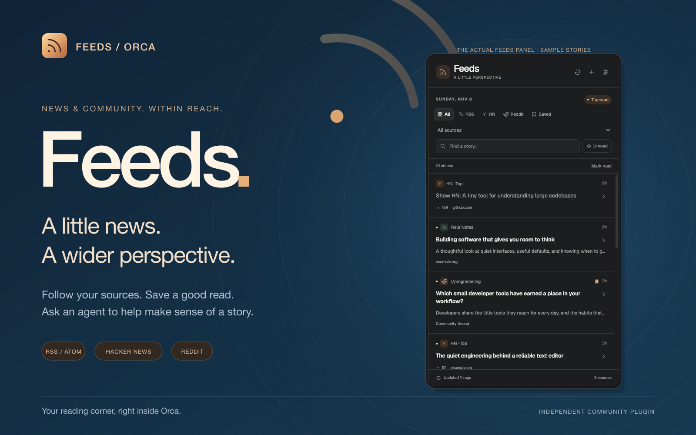
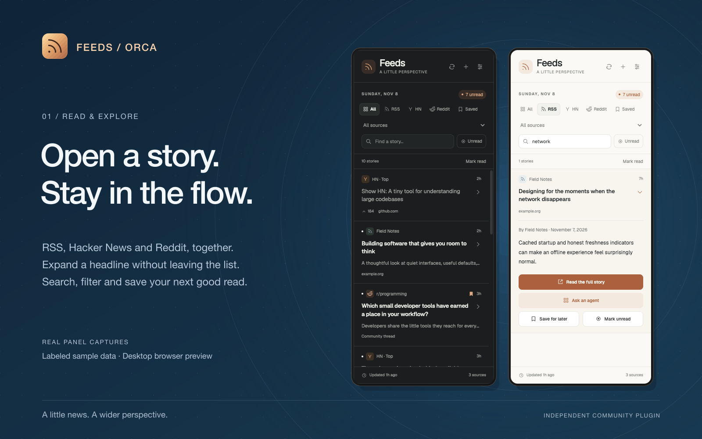
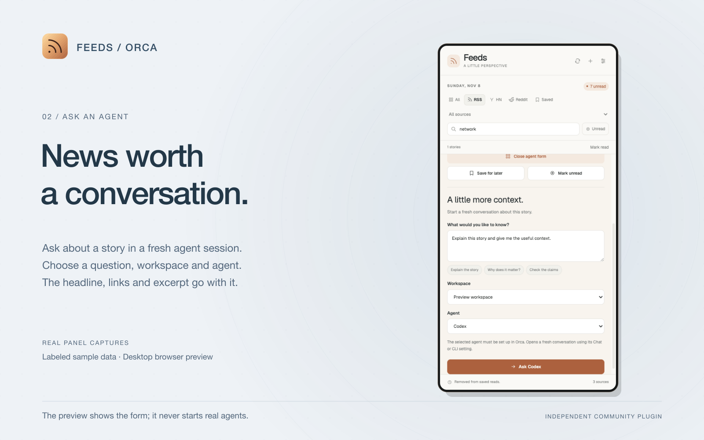

# Feeds for Orca

**A little news. A wider perspective.**

RSS and Atom, Hacker News, and public Reddit communities in one quiet sidebar. Follow your sources, save a good read, and ask an agent to help make sense of a story.

Version **0.1.0** is prepared locally for release. Publication instructions and the proposed repository are in [RELEASE.md](RELEASE.md).

## Install

Requires **Orca desktop 1.4.253 or newer**. The repository includes the compiled worker, panel, dependencies and font. Reading feeds needs no npm install, service, account or API key.

Once **v0.1.0** is published:

1. Open **Settings → Plugins**.
2. Choose **Add plugin → From a Git URL…** and enter:

   ```text
   https://github.com/faisalmuhammad/orca-news-feeds#v0.1.0
   ```

   Keep #v0.1.0 at the end to install the release tag.

3. Review and approve the trusted worker, private storage, workspace discovery and agent-launch access.
4. Open **Feeds** from the globe icon in the right sidebar.

For local use before publication, add this folder through **Settings → Plugins → Development folders…**.

The library starts empty. Choose a starter to follow with one click, or use **+ → Add a source** for an RSS/Atom URL, Hacker News category or subreddit.

## Preview

| Read and expand                                                                     | Ask an agent                                                                         |
| ----------------------------------------------------------------------------------- | ------------------------------------------------------------------------------------ |
|  |  |

These images use the actual panel in Orca’s embedded browser, with labeled sample stories and an isolated preview library. The agent image shows its question form. [Screenshot and artwork provenance](assets/SCREENSHOTS.md).

## Use

Select a headline or its chevron to expand its row. Excerpts, source links, read/save actions and agent questions appear inline. Opening another story closes the previous row and its question form.

**All**, **RSS**, **HN**, **Reddit** and **Saved** views, a source selector and local search narrow the list. Combined feeds show newest stories first; individual feeds retain their source ordering. Saved snapshots survive source removal and ordinary cache eviction.

Refresh is manual by default. Settings offer optional 5/10/30/60-minute refresh while the panel is visible and focused, source renaming or pausing, and compact headlines. A failed refresh keeps the last successful headlines and shows a source error.

**Keyboard:** Up/Down moves between focused headlines; Enter/Space expands or collapses; **S** saves or unsaves. Escape closes the question form, then collapses the story. Search and form fields retain normal keyboard behavior.

## Follow your curiosity

All built-in choices are free public feeds. Starter suggestions are opt-in: Feeds follows only the ones you select. Availability and rate limits depend on the provider.

| Source      | Available choices                                                                                       |
| ----------- | ------------------------------------------------------------------------------------------------------- |
| RSS / Atom  | Lobsters, Cloudflare, TypeScript, GitHub Blog, Mozilla Hacks, Stack Overflow Blog, or your own feed URL |
| Hacker News | Top, New, Best, Ask, Show                                                                               |
| Reddit      | r/programming, r/webdev, r/javascript, r/typescript, r/rust, r/technology, or another public subreddit  |

The welcome screen offers Lobsters, Cloudflare and TypeScript. All RSS and Reddit suggestions also appear under **Add a source**, with one-click **Follow** and duplicate detection. Reddit supports **Hot**, **New** and **Top today**.

Feeds supports RSS 2.0, RSS 1.0/RDF and Atom. Feed-supplied images appear as thumbnails beside headlines and full previews when expanded. Compact mode shows images only inside expanded stories. Missing images collapse away. Hacker News’s API supplies no images; Feeds does not scrape articles to find them.

Excerpts are plain text. Full articles, voting, posting, video and nested discussion threads open on the source website. Reddit uses public Atom feeds, which may be restricted or rate limited.

## Ask an agent

Expand a story, choose **Ask an agent**, and enter a question or use a suggestion. Pick a workspace and a configured agent, then choose **Ask Codex**, **Ask Claude** or **Ask Gemini**.

Feeds starts a **fresh conversation** through Orca’s bundled CLI, honors the agent’s **Chat / CLI** setting and focuses the new tab. Your question includes the headline, source links, date when available and feed excerpt. The agent is asked to read the source when its tools permit and cite what it finds. Agents must already be configured in Orca; normal agent usage costs apply.

Success requires Orca to confirm delivery of the question. Retrying an uncertain launch with an operation ID replays the original request. Without a replay ID, Feeds asks you to check the workspace before attempting a new conversation. Reopening the form keeps its question and receipt.

Floating-window creation is unavailable through the current public host API/CLI. See [COMPATIBILITY.md](COMPATIBILITY.md) for host behavior and verified coverage.

## Access and privacy

| Access              | Purpose                                                                        |
| ------------------- | ------------------------------------------------------------------------------ |
| Trusted Node worker | Fetch feeds/images and invoke Orca’s CLI for explicit agent requests           |
| storage:own         | Store subscriptions, caches, saved/read state, preferences and launch receipts |
| workspace:read      | Offer workspaces for a new conversation                                        |
| agent:launch        | Start the selected agent when you submit a question                            |

The worker runs with your user account’s authority. There is no analytics or cloud sync. Requests go to selected feed/image sources; story context goes to your chosen agent when you ask. External links use Orca’s normal consent flow.

Preview images load lazily as bounded PNG/JPEG/WebP/GIF data and stay briefly in memory. Image bytes are never persisted with saved stories. Atomic storage generations preserve the previous committed library if a write fails.

Initial limits: 50 sources, 200 ordinary cached entries per source, 500 saved stories and a 15 MiB serialized store. Fetches have cancellation, size/time limits, conditional headers and provider backoff.

## Build and verify

Use **Node.js 22+**, npm and Orca desktop. These commands apply to the source folder with build/ and tests/. Orca installs the compiled runtime directly from the tagged repository.

```sh
npm ci --prefix build
npm run typecheck
npm test
orca plugin test . --json
orca plugin validate . --json
orca plugin check . --json
```

For browser verification and release images:

```sh
npm run preview
# In another terminal, with Orca open:
npm run release:shots
npm run release:art
npm run release:notices
npm run release:check
```

The preview at **http://127.0.0.1:4329** uses sample feeds and separate .orca/preview/ storage. It never starts real agents or changes the installed library. Checks cover 240/320/440 px, both themes, keyboard navigation, inline expansion, source suggestions, image transfer and launch mocks.

Publish the compiled runtime and listing assets in Git, then create a release pointing to the tag. Release archives are optional local tooling and are not uploaded. Re-render committed captures without a browser using:

```sh
npm run release:shots -- --from-captures
npm run release:art
```

The source folder also includes build/README.md for development details. See [RELEASE.md](RELEASE.md) and [CHANGELOG.md](CHANGELOG.md).

## License

Original code and artwork use [MIT](LICENSE). Bundled dependency and Geist font licenses are in [THIRD_PARTY_NOTICES.md](THIRD_PARTY_NOTICES.md). Feeds is an independent community plugin, unaffiliated with Orca, Hacker News, Reddit or the publications you follow.
